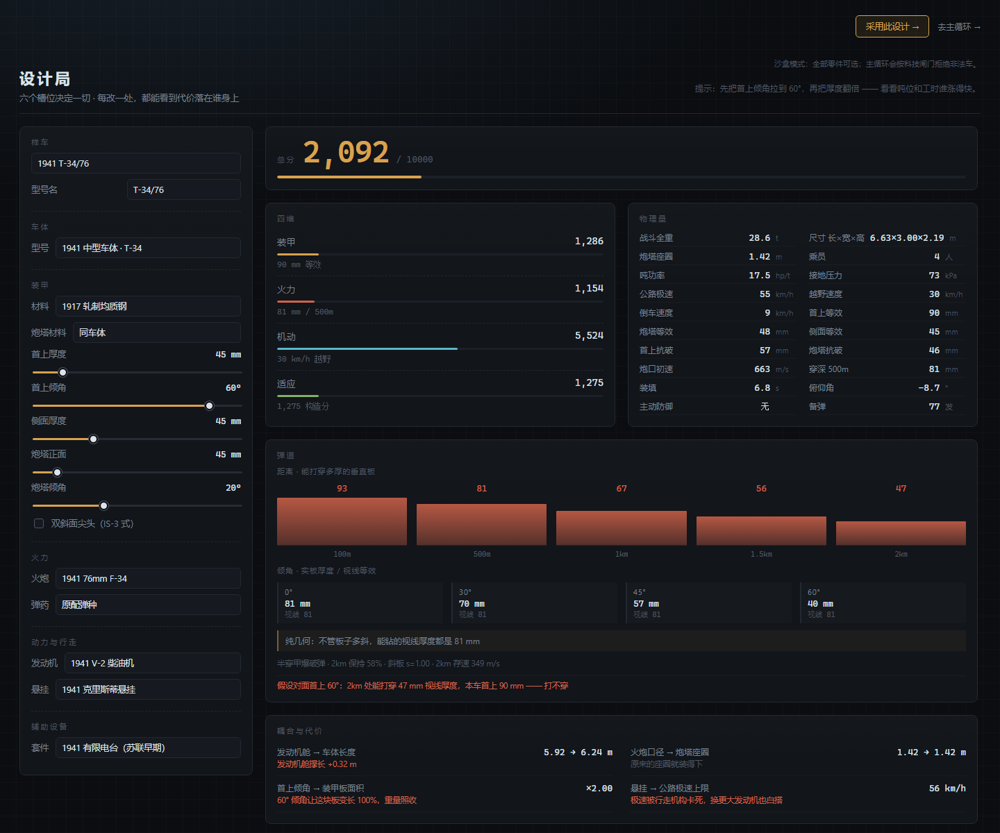
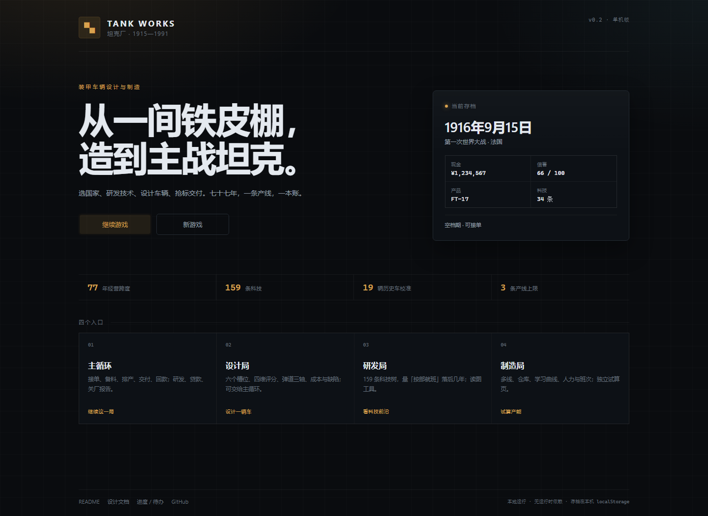
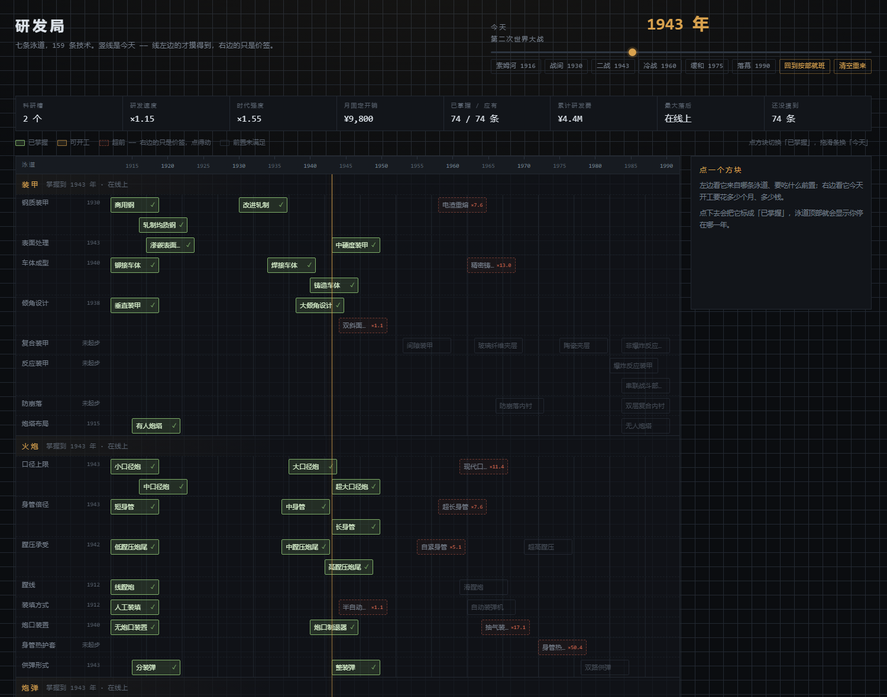
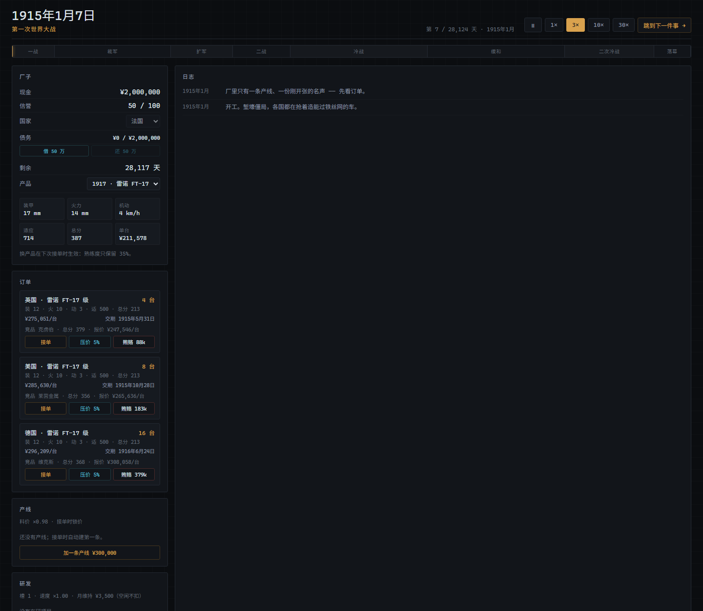

# 坦克厂

1915 年开一家默默无闻的小坦克厂，一路经营到 1991 年冷战结束。

文字模拟经营。核心不是点科技树，是**在物理约束下做工程取舍**：装甲厚一点就重一点，炮大一点炮塔就大一点，发动机强一点车体就长一点——每一项性能都要用重量、工时、钱去换。

> **当前状态**：设计局、研发局、制造局、游说局都已跑通；贷款/关厂报告/多产线/料价/尺度 v1 已接。
> **设计局的车能交给主循环去卖，科技树也接进了游戏**：研发项目、槽位/速度、零件与倾角/口径闸门都在跑；
> 设计局会读主循环的科技快照；抗破、装填、倒车、俯仰、主动防御已进读数；科技 `fn` 已全部接线。
> 同一时间只能有一张订单；竞品 AI 是轻量版；多合同评估后暂不做；联机按当前要求不做。
>
> - 进度、待办、技术债、需求覆盖：[docs/STATUS.md](docs/STATUS.md)
> - 设计全文（玩法 / 物理模型 / 数值 / 决策记录）：[docs/DESIGN.md](docs/DESIGN.md)
> - 需求原件：[docs/原始需求.docx](<docs/原始需求.docx>)





## 现在能打开什么

| 入口 | 是什么 | 状态 |
| --- | --- | --- |
| `/` | **主菜单**：继续存档 / 新游戏 / 四个入口 | ✅ |
| `/game.html` | 游戏壳：时钟 + 产品 + 招标 + 产线 + 现金 | ✅ 能接单、生产、交付、回款 |
| `/tank.html` | 设计局：六个槽位拼车，四维评分 + 耦合代价 + 弹道三轴 + 成本 | ✅ 完整 · 可交给主循环 |
| `/research.html` | 研发局：1912–1991 年时间轴，7 条泳道，一条「今天」的竖线 | ✅ 读图工具，不存档 |
| `/manufacture.html` | 制造局：产线、仓库、学习曲线、成本摊薄 | ✅ 独立试算页（主循环用同一模型） |



调试入口：

```
/game.html?day=9009            从 1939-09-01 开局
/tank.html?tank=虎王           直接打开某辆历史车
/research.html?year=1960       把「今天」拨到 1960
/manufacture.html?days=200     制造局开局直接推进 200 天
```

## 快速开始

```bash
npm install
npm run dev        # http://127.0.0.1:5273/  （根路径是主菜单）
npm run check      # 类型检查 + 校准 + 弹道 + 科技节奏 + 时钟 + 研发 + 指标 + 尺度 + 经济 + 五套界面冒烟 = 420 项断言
npm run build      # 打包到 dist/（相对路径，可直接 file:// 打开）
```

## 一局怎么玩

1. 开局先选国家（菜单里可改，开工后锁定）：它决定你能卖给哪个阵营。
2. （可选）去 `/tank.html` 改一辆车，点右上角「采用此设计」；回主循环点「导入设计局的车」。
3. 在「研发」里挑下一项技术：超前更贵，落后打折；槽位和速度可以在年份到了以后买。
4. 在「订单」里挑一份标：看竞品总分，决定原价接、压价 5%，还是花钱贿赂。
5. 接单 → 厂里自动备料、开线；时间每走一天，扣工资、出车、交付、回款。
6. 产能不够就在「产线」里加第二条（最多 3 条）、扩编、加班；所有线共享仓库与成品池。
7. 交完自动回到招标；空档期可以换产品，下一次接单时换型，熟练度只保留 35%。
8. 逾期交付按 70% 结算；信誉涨跌会改报价；贿赂每年可能被审计；现金见底时银行先自动透支。
9. 现金 < 0 且授信用满才破产；1991 年关厂时弹出结算总表（回款 / 材料 / 工资 / 研发 / 贿赂 / 利息 / 债务）。

## 四个局

```
研发局 ──► 设计局 ──► 制造局 ──► 游说局 ──┐
  ▲                                        │
  └──────────────── 钱 ────────────────────┘
```

- **研发局**：花钱 + 花时间，把 159 条技术变成「能选的零件」。超前研发更贵，落后补课有折扣。
- **设计局**：六个槽位拼车，得到物理量、四维评分、单台成本。七步管线全是纯函数。
- **制造局**：排产、囤料、换型。一条线一种车，学习曲线让长时间造同一种车更便宜。
- **游说局**：挑客户、报价、塞钱。竞品报价、压价、贿赂、信誉、审计、国家/阵营限制都接了。

## 三个数字

| 数字 | 是什么 |
| --- | --- |
| **28,124** | 1915-01-01 到 1991-12-31 的天数。连续时间，不是回合制 |
| **159** | 技术条目 = 65 个梯子 × 若干世代；其中 148 条在 1991 年前，11 条是终局清单 |
| **19** | 历史坦克校准集（FT-17 → M1A1HA）。装甲平均误差 **1.7%**，穿深 11.3%，越野 12.6% |

校准、弹道两轴、槽月预算的推导和表格都在 [DESIGN.md](docs/DESIGN.md)，这里不复述。

## 代码结构

```
src/tank/
  model/     物理模型：几何、质量、装甲、弹道、机动、适应、评分、成本、设计年代（纯函数，无 DOM / 无随机）
  data/      部件表、159 条技术、19 辆历史车
  sim/       日历、状态、推进、存档、制造局、订单经济
  ui/        设计局 / 研发局 / 制造局界面（唯一碰 DOM 的地方）
  game/      游戏壳：走时、产品、招标、产线、渲染节流
src/platform/  SaveStore 抽象 + 设计局→主循环的设计交接（localStorage）
probe/        校准台、预算台、标定器（不进产物）
tools/        界面冒烟测试 + 文档表格生成
```

分层规矩：`model/` 和 `sim/` 不 import 任何 DOM 的东西，所以同一份规则能在浏览器里跑，也能在 Node 里被检查台和标定器复用。

## 版本管理

远程仓库：<https://github.com/JiangYiJiang/tank-works>（`main` 已跟踪 `origin/main`）。日常：

```bash
git add -A && git commit -m "..."
git push
```

GitHub 不接受账号密码：push 的 Password 处要填 **Personal Access Token**（GitHub → Settings → Developer settings → Personal access tokens，勾 `repo`）。第一次输入后由 Windows 凭据管理器（`credential.helper=wincred`）保存。`.gitignore` 已排除 `node_modules/`、`dist/`、`.tmp/`；Windows 上 `git add` 提示的 CRLF 是正常现象。

## 已知边界

完整清单在 [STATUS §3](docs/STATUS.md)，最要紧的五条：

- **游说局仍没有竞品 AI**：竞品有名字、逐年成长、报价；但不会自己推新车、抢标、打价格战。
- **竞品 AI 是轻量版**：8 家竞品、逐年成长、换代发新车、每标竞价；不会自主设计新车型或抢单。
- **单合同**：同一时间只能执行一张订单；多线是并行生产同一产品，不能同时接两单。
- **经济尺度 v1 是内部标定**：毛利 15–25%、单台 3–13 天、4 台小单利润够付首项技术；不追真实历史美元。
- **最多 3 条线**：单线最多 400 人 / 3 班；加线、扩编、加班都收一次性费用。
- **设计局可沙盒**：没有主循环科技快照时全部零件可选；进了游戏之后按科技过滤，采用时也会拦非法车。
- **技术 `fn` 只剩两项没接**：斜板响应 / 2km 保持 / 破甲弹口径倍数 / 发射药 / 工时已经进模型；`density`（弹芯密度）和 `barrelLife`（炮管寿命）还没接。
- **抗破已进设计局，但订单仍只验收抗穿**：破甲弹的自检已经按抗破判；装填 / 倒车 / 俯仰是读数，不进四维评分。
- **经济尺度是临时的**：开局 200 万，单价 = 同期参照车成本 ×1.3–1.4，还没按真实军贸价校对。


