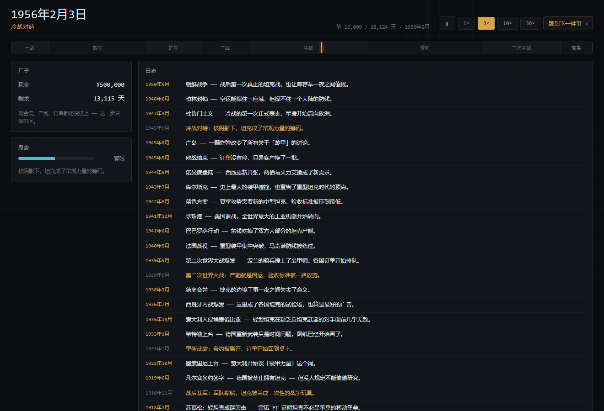

# 坦克厂

1915 年开一家默默无闻的小坦克厂，一路经营到 1991 年冷战结束。

文字模拟经营。核心不是点科技树，是**在物理约束下做工程取舍**：装甲厚一点就重一点，炮大一点炮塔就大一点，发动机强一点车体就长一点——每一项性能都要用重量、工时、钱去换。

> **当前状态**：设计局、研发局已跑通；制造局可用，但仍是独立页；游说局只有设计稿。
> **四个局尚未接成一条循环。**
>
> - 进度、待办、技术债、需求覆盖：[docs/STATUS.md](docs/STATUS.md)
> - 设计全文（玩法 / 物理模型 / 数值 / 决策记录）：[docs/DESIGN.md](docs/DESIGN.md)
> - 需求原件：[docs/原始需求.docx](<docs/原始需求.docx>)


## 现在能打开什么

| 入口 | 是什么 | 状态 |
| --- | --- | --- |
| `/` | 根路径：自动跳转到游戏壳 | ✅ |
| `/game.html` | 游戏壳：28,124 天的日历、时代、威胁水位、历史快讯、存档 | ✅ 时间会走，但现金是死的 |
| `/tank.html` | 设计局：六个槽位拼车，四维评分 + 耦合代价 + 弹道三轴 + 成本 | ✅ 完整 |
| `/research.html` | 研发局：1912–1991 年时间轴，7 条泳道，一条「今天」的竖线 | ✅ 读图工具，不存档 |
| `/manufacture.html` | 制造局：产线、仓库、学习曲线、成本摊薄 | ⚠️ 独立页，回款是占位公式 |


调试入口：

```
/game.html?day=9009            从 1939-09-01 开局
/tank.html?tank=虎王           直接打开某辆历史车
/research.html?year=1960       把「今天」拨到 1960
/manufacture.html?days=200     制造局开局直接推进 200 天
```

## 快速开始

```bash
npm install
npm run dev        # http://127.0.0.1:5273/  （根路径自动跳转到 game.html）
npm run check      # 类型检查 + 校准 + 弹道 + 科技节奏 + 时钟 + 四套界面冒烟 = 123 项断言
npm run build      # 打包到 dist/（相对路径，可直接 file:// 打开）
```

## 四个局

```
研发局 ──► 设计局 ──► 制造局 ──► 游说局 ──┐
  ▲                                        │
  └──────────────── 钱 ────────────────────┘
```

- **研发局**：花钱 + 花时间，把 159 条技术变成「能选的零件」。超前研发更贵，落后补课有折扣。
- **设计局**：六个槽位拼车，得到物理量、四维评分、单台成本。七步管线全是纯函数。
- **制造局**：排产、囤料、换型。一条线一种车，学习曲线让长时间造同一种车更便宜。
- **游说局**：挑客户、报价、塞钱。**尚未实现**，只有 [DESIGN §9](docs/DESIGN.md) 的设计稿。

## 三个数字

| 数字 | 是什么 |
| --- | --- |
| **28,124** | 1915-01-01 到 1991-12-31 的天数。连续时间，不是回合制 |
| **159** | 技术条目 = 65 个梯子 × 若干世代；其中 148 条在 1991 年前，11 条是终局清单 |
| **19** | 历史坦克校准集（FT-17 → M1A1HA）。装甲平均误差 **1.7%**，穿深 11.3%，越野 12.6% |

校准、弹道两轴、槽月预算的推导和表格都在 [DESIGN.md](docs/DESIGN.md)，这里不复述。

## 代码结构

```
src/tank/
  model/     物理模型：几何、质量、装甲、弹道、机动、适应、评分、成本（纯函数，无 DOM / 无随机）
  data/      部件表、159 条技术、19 辆历史车
  sim/       日历、状态、推进、存档、制造局
  ui/        设计局 / 研发局 / 制造局界面（唯一碰 DOM 的地方）
  game/      游戏壳：走时、渲染节流、自动暂停
src/platform/  SaveStore 抽象（localStorage / 内存 / 将来的文件）
probe/        校准台、预算台、标定器（不进产物）
tools/        界面冒烟测试 + 文档表格生成
```

分层规矩：`model/` 和 `sim/` 不 import 任何 DOM 的东西，所以同一份规则能在浏览器里跑，也能在 Node 里被检查台和标定器复用。

## 版本管理

仓库已初始化（`main`）并完成首个基线提交（63 个文件）。推送前先在 GitHub 建一个**空仓库**（不要勾 README / .gitignore / license），然后：

```bash
git remote add origin <仓库地址>
git push -u origin main
```

GitHub 不接受账号密码：第一次 push 时，

- **Username** 填 GitHub 用户名；
- **Password** 填 **Personal Access Token**（GitHub → Settings → Developer settings → Personal access tokens，勾 `repo`）。

凭据会存进 Windows 凭据管理器（`credential.helper=wincred`），之后不用再输。`.gitignore` 已排除 `node_modules/`、`dist/`、`.tmp/`；Windows 上 `git add` 提示的 CRLF 是正常现象。

## 已知边界

完整清单在 [STATUS §3](docs/STATUS.md)，最要紧的四条：

- **没有收入**：游说局未实现，制造局只能看到花钱。
- **技术 `fn` 未接线**：科技树目前只影响「看得见」，不影响造出来的车。
- **抗破（CE）只算不判**：复合装甲的化学能防护还没有进入判定。
- **经济尺度未定**：T-34 单台 ¥550,310，而开局现金只有 ¥500,000。


