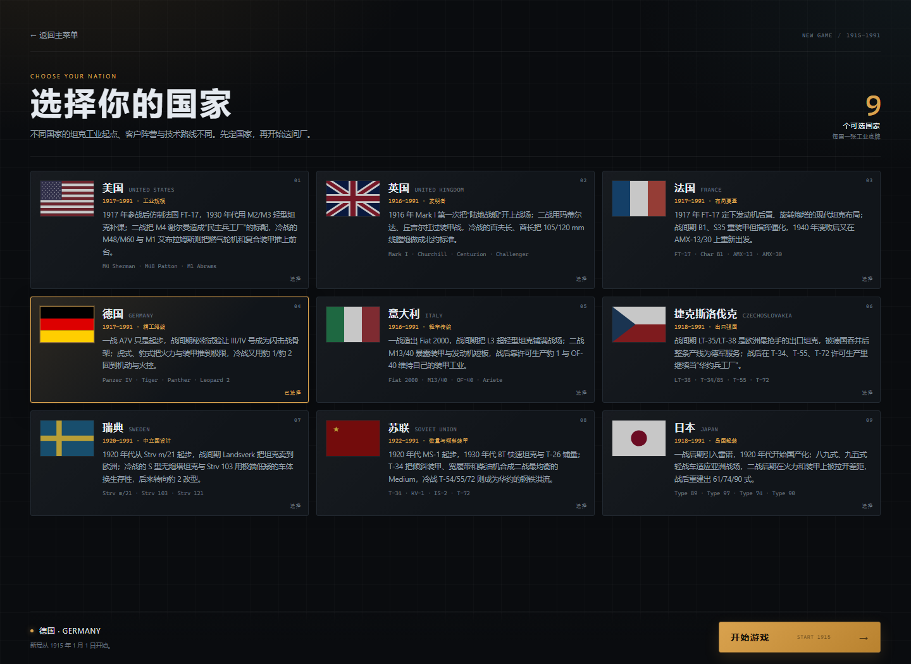
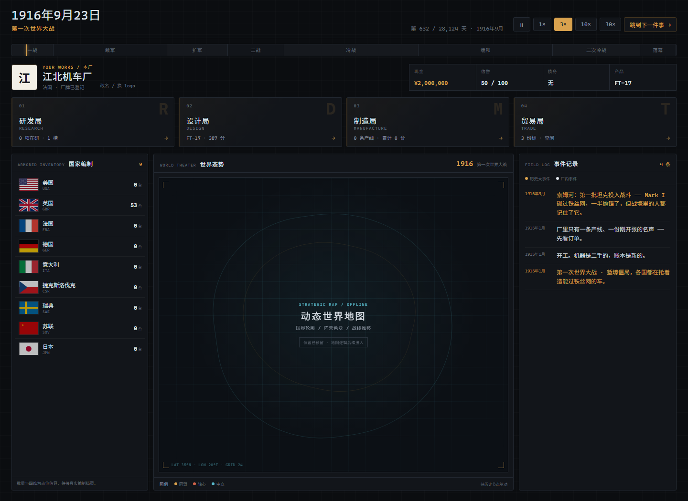
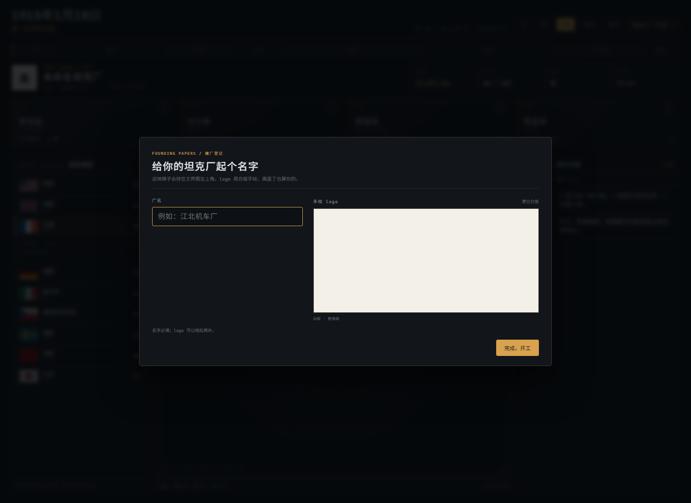
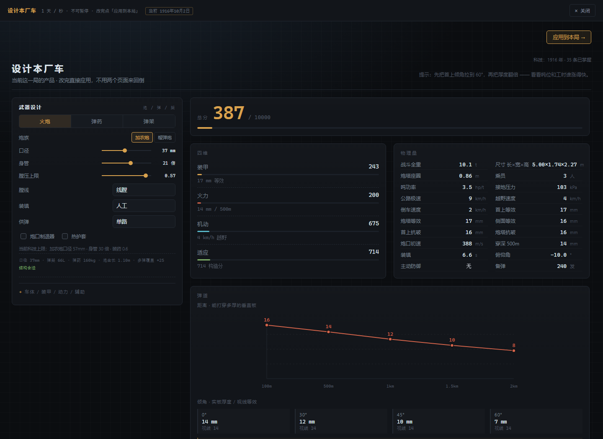
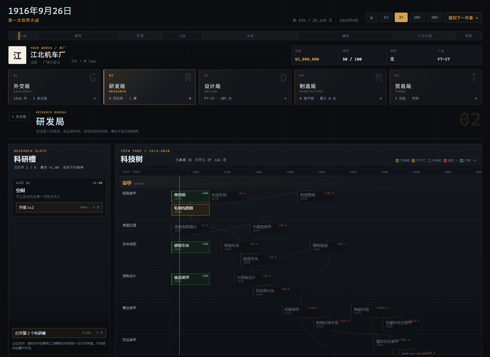
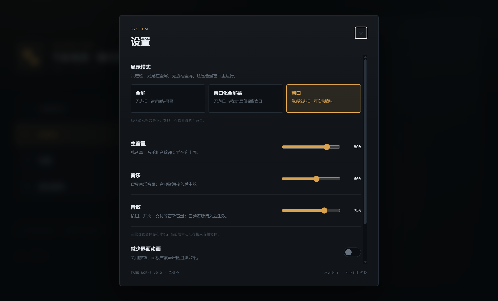

# 坦克厂

1915 年开一家默默无闻的小坦克厂，一路经营到 1991 年冷战结束。

文字模拟经营。核心不是点科技树，是**在物理约束下做工程取舍**：装甲厚一点就重一点，炮大一点炮塔就大一点，发动机强一点车体就长一点——每一项性能都要用重量、工时、钱去换。

> **当前状态**：外交局、设计局、研发局、制造局、贸易局都已跑通；贷款/关厂报告/多产线/料价/尺度 v1 已接；Windows 桌面版已能出 NSIS / portable `.exe`。
> **新游戏先选国家**：主菜单「新游戏」两次确认后进入 9 国选择页，国旗、国名、坦克发展历程都在这一页。
> **阵营系统暂关**：旧的 1939–45 同盟/轴心、1947–91 东西方分段已移除，所有国家都能向所有客户供货；后续按法国 1940、美国 1917 这类历史事件重新设计。
> **设计局的车现在在游戏内设计**：产品面板点「设计本厂车」，武器分「火炮 / 弹药 / 弹架」三页；改完直接应用到这一局，独立 `/tank.html` 只作预览。
> 科技决定可用零件、口径/身管/装药边界与弹药种类；抗破、装填、倒车、俯仰、主动防御已进读数；科技 `fn` 已全部接线。
> 同一时间只能有一张订单；竞品 AI 是轻量版；多合同评估后暂不做；联机按当前要求不做。
>
> - 进度、待办、技术债、需求覆盖：[docs/STATUS.md](docs/STATUS.md)
> - 设计全文（玩法 / 物理模型 / 数值 / 决策记录）：[docs/DESIGN.md](docs/DESIGN.md)
> - 需求原件：[docs/原始需求.docx](<docs/原始需求.docx>)










## 现在能打开什么

| 入口 | 是什么 | 状态 |
| --- | --- | --- |
| `/` | **主菜单**：加载游戏 / 新游戏 / 设置 / 退出游戏；右侧留背景图位 | ✅ |
| `/nations.html` | **选国家**：9 张国家卡，国旗、国名、坦克发展历程；选中后开始新局 | ✅ |
| `/game.html` | **游戏主界面**：时钟/历史线 + 外交/研发/设计/制造/贸易五卡 + 9 国编制 + 地图占位 + 事件记录 | ✅ 默认外交局，能接单、生产、交付、回款 |
| `/tank.html` | 设计局独立页：武器（炮/弹/架）+ 车体/装甲/动力，供预览/调试 | ✅ 只读预览 · 游戏内才是正式入口 |
| `/research.html` | 研发局读图页：1912–1991 年时间轴，7 个板块，一条「今天」的竖线 | ✅ 读图工具，不存档 |
| `/manufacture.html` | 制造局：产线、仓库、学习曲线、成本摊薄 | ✅ 独立试算页（主循环用同一模型） |

主菜单四个按钮：**加载游戏**读本地存档；**新游戏**有存档时两次确认，然后进入 `/nations.html` 选国家；**设置**可切显示模式、调主音量/音乐/音效、减少界面动画、清除本局存档；**退出游戏**在桌面版直接关游戏，浏览器版进入退出页（浏览器不能可靠关闭当前标签页）。右侧是背景图占位，后续再定内容。

选国家页只列首批 9 国：美国、英国、法国、德国、意大利、捷克斯洛伐克、瑞典、苏联、日本。点国旗或卡片高亮，底部「开始游戏」才亮起；**开始游戏时才清除旧存档**，所以在国家页反悔还能返回主菜单读旧档。

第一次进入主界面会先弹「建厂登记」：给厂子起名，在白板上手绘 logo；登记期间时钟冻结。之后顶部保留日期/时代/速度/历史线，下面五张卡进入外交、研发、设计、制造、贸易五个局；**默认是外交局**。外交局左侧是 9 国装甲编制（点开看型号、四维、总分、数量，列表可滚动），中间是动态世界地图的占位框，右侧是事件记录（历史大事件琥珀色，厂内事件白色）。切到其他局时，顶部读数、五张卡和历史线都不动，只换卡片下面的内容。

研发局左侧是科研槽：开局只有 1 个，最多 6 个；每个槽可以单独升级（升级期间该槽不能开工），解锁/升级都要花钱和时间。右侧是完整科技树：7 个板块、66 条泳道、161 项科技，按年份横向排开，当前年份有一条竖线；卡片按已掌握/在研/可开工/未解锁区分，超前研发与追赶折扣各有徽标，前置科技用连线标出。点卡片可以看介绍、前置和预计工期，再决定开工。



调试入口：

```
/game.html?design=1             直接打开游戏内设计覆盖层
/game.html?day=9009            从 1939-09-01 开局
/game.html?day=0&home=ger       跳过选国家页，直接开德国局
/game.html?view=trade           直接打开贸易局页（diplomacy / research / manufacture 同理；外交局是默认）
/research.html?year=1960       把「今天」拨到 1960
/manufacture.html?days=200     制造局开局直接推进 200 天
```

## 快速开始

```bash
npm install
npm run dev        # http://127.0.0.1:5273/  （根路径是主菜单）
npm run check      # 类型检查 + 校准 + 弹道 + 科技节奏 + 时钟 + 研发 + 指标 + 尺度 + 经济 + 16 个检查台 = 655 项断言
npm run build      # 打包到 dist/（相对路径，可直接 file:// 打开）
```

## 桌面版（Windows .exe）

同一份 `dist` 现在也能装进 Electron 壳，像普通 Windows 游戏一样双击启动：

```bash
npm run desktop:dev    # Vite + Electron 开发窗口
npm run desktop:build  # 只打桌面壳（desktop-dist/）
npm run desktop:pack   # 构建 + 桌面壳 + electron-builder，产物在 release/
```

产物：

- `release/Tank Works-0.2.0-x64.exe` —— NSIS 安装包（可选安装目录、桌面快捷方式）
- `release/Tank Works-0.2.0-portable.exe` —— 免安装，双击即玩

主菜单「设置」里可以切 **窗口 / 窗口化全屏幕 / 全屏**，并设置主音量、音乐、音效。显示模式切换会重开窗口（Electron 不能运行时改窗口边框），存档和设置不会丢。音量目前只保存数值，**音频资源还没接入**。首次 `npm install` 如果 Electron 二进制下载失败，设置 `ELECTRON_MIRROR=https://npmmirror.com/mirrors/electron/` 后重跑 `node node_modules/electron/install.js`；打包下载失败时设 `ELECTRON_BUILDER_BINARIES_MIRROR=https://npmmirror.com/mirrors/electron-builder-binaries/`。

桌面版没有代码签名，Windows SmartScreen 会提示「未知发布者」；选择「更多信息 → 仍要运行」即可。

如果从已经设置 `ELECTRON_RUN_AS_NODE=1` 的终端启动（本机开发环境就有），Electron 会退化成 Node 并直接退出；先 `Remove-Item Env:ELECTRON_RUN_AS_NODE` 再启动。双击 exe 不受影响，`npm run desktop:dev` 也已在子进程里删掉这个变量。



## 一局怎么玩

1. 进游戏先给厂子起名、画 logo；主界面顶部走时间，下面五张卡进五个局，默认停在外交局看 9 国编制和事件记录。
2. 新游戏先选国家（首次开工后锁定）：目前它决定厂旗、开局身份与存档里的 `home`；阵营限制暂关，所有国家都能向所有客户供货。阵营系统后续会按历史重做。
3. 在「制造局 → 产品」点 **「设计本厂车」**：武器页调炮/弹/架，底盘页调车体/装甲/动力；改完点「应用到本局」。设计局按 **1 游戏天 / 现实 1 秒** 走时，不能暂停/调速/跳事件；切到后台自动暂停，离开时恢复原来的倍速。也可以去独立设计页预览。
4. 在「研发局」里挑下一项技术：左侧科研槽开局 1 个、最多 6 个，可花时间和钱解锁/升级；右侧科技树按前置连线解锁，点卡片看预计工期再开工。超前更贵，落后打折。
5. 在「贸易局」里挑一份标：看竞品总分，决定原价接、压价 5%，还是花钱贿赂。
6. 接单 → 厂里自动备料、开线；时间每走一天，扣工资、出车、交付、回款。
7. 产能不够就在「制造局 → 产线」里加第二条（最多 3 条）、扩编、加班；所有线共享仓库与成品池。
8. 交完自动回到招标；空档期可以换产品，下一次接单时换型，熟练度只保留 35%。
9. 逾期交付按 70% 结算；信誉涨跌会改报价；贿赂每年可能被审计；现金见底时银行先自动透支。
10. 现金 < 0 且授信用满才破产；1991 年关厂时弹出结算总表（回款 / 材料 / 工资 / 研发 / 贿赂 / 利息 / 债务）。

## 五个局

```
外交局（看世界）
   │
研发局 ──► 设计局 ──► 制造局 ──► 贸易局 ──┐
  ▲                                        │
  └──────────────── 钱 ────────────────────┘
```

- **外交局**：看 9 国编制、世界态势、历史/厂内事件；当前是默认页和主界面的“看世界”入口。
- **研发局**：左侧科研槽负责并行与速度，右侧完整科技树负责路线与前置。花钱 + 花时间，把 161 条技术变成「能选的零件」。口径分「加农炮」与「榴弹炮」两条线：1939 年解锁的 152mm 短管榴弹炮能造 KV-2，但不会顺带放开高初速 152mm 加农炮。超前研发更贵，落后补课有折扣；槽位解锁/升级的数值目前是占位，等经济系统统一设计后再调。
- **设计局**：武器页负责炮/弹/架，底盘页负责车体/装甲/动力。炮决定口径、倍径、膛压与装填；每车可带 1–4 种唯一弹种，弹长/装药/数量都会占用弹架体积与车重；每辆车设计自己的弹，不是全局弹库。设计本身不收额外费用，但设计局内时间按 1 天/秒推进，工资、产线、交期照常走。
- **制造局**：排产、囤料、换型。一条线一种车，学习曲线让长时间造同一种车更便宜。
- **贸易局**：挑客户、报价、塞钱。竞品报价、压价、贿赂、信誉、审计都接了；阵营/出口限制暂关，待按历史重做。

五个局都在游戏内：外交/研发/制造/贸易打开对应工作页，设计局打开全屏设计覆盖层；独立页面只作预览/调试。

## 三个数字

| 数字 | 是什么 |
| --- | --- |
| **28,124** | 1915-01-01 到 1991-12-31 的天数。连续时间，不是回合制 |
| **161** | 技术条目 = 66 个梯子 × 若干世代；其中 150 条在 1991 年前，11 条是终局清单 |
| **19** | 历史坦克校准集（FT-17 → M1A1HA）。装甲平均误差 **1.7%**，穿深 11.3%，越野 12.6% |

校准、弹道两轴、槽月预算的推导和表格都在 [DESIGN.md](docs/DESIGN.md)，这里不复述。

## 代码结构

```
src/tank/
  model/     物理模型：几何、质量、装甲、弹道、机动、适应、评分、成本、设计年代、武器参数化（纯函数，无 DOM / 无随机）
  data/      部件表、161 条技术、19 辆历史车、9 国档案与国旗、9 国装甲编制（占位）
  sim/       日历、状态、推进、存档、制造局、订单经济
  ui/        设计局（武器三页 + 底盘）/ 研发局 / 制造局界面（独立读图页）
  game/      主界面 + 五局工作页 + 研发槽/科技树 + 建厂登记 + 设计时间 + 走时/渲染节流
  nation-main.ts  国家选择页（卡片、选中态、开始新局）
src/platform/  SaveStore、存档键、设置、桌面桥、公司厂牌、设计/科技交接
desktop/       Electron 主进程 / preload / esbuild / 打包脚本
build/         应用图标（icon.ico / icon.png）
probe/         校准台、预算台、标定器（不进产物）
tools/         界面冒烟测试 + 文档表格生成
```

分层规矩：`model/` 和 `sim/` 不 import 任何 DOM 的东西，所以同一份规则能在浏览器里跑，也能在 Node 里被检查台和标定器复用。`desktop/` 只碰窗口、协议和打包，不碰模拟规则。

## 版本管理

远程仓库：<https://github.com/JiangYiJiang/tank-works>（`main` 已跟踪 `origin/main`）。日常：

```bash
git add -A && git commit -m "..."
git push
```

GitHub 不接受账号密码：push 的 Password 处要填 **Personal Access Token**（GitHub → Settings → Developer settings → Personal access tokens，勾 `repo`）。第一次输入后由 Windows 凭据管理器（`credential.helper=wincred`）保存。`.gitignore` 已排除 `node_modules/`、`dist/`、`.tmp/`；Windows 上 `git add` 提示的 CRLF 是正常现象。

## 已知边界

完整清单在 [STATUS §3](docs/STATUS.md)，最要紧的几条：

- **贸易局竞品是轻量 AI**：竞品有名字、逐年成长、报价、换代发新车、每标竞价；但不会自主设计新车型或抢单。
- **单合同**：同一时间只能执行一张订单；多线是并行生产同一产品，不能同时接两单。
- **经济尺度 v1 是内部标定**：毛利 15–25%、单台 3–13 天、4 台小单利润够付首项技术；不追真实历史美元。
- **最多 3 条线**：单线最多 400 人 / 3 班；加线、扩编、加班都收一次性费用。
- **设计局可沙盒**：没有主循环科技快照时全部零件可选；进了游戏之后按科技过滤，采用时也会拦非法车。
- **抗破已进设计局，但订单仍只验收抗穿**：破甲弹的自检已经按抗破判；装填 / 倒车 / 俯仰是读数，不进四维评分。
- **经济尺度是临时的**：开局 200 万，单价 = 同期参照车成本 ×1.3–1.4，还没按真实军贸价校对。
- **阵营系统暂关**：旧分段（1939–45 同盟/轴心、1947–91 东西方）已移除，所有进入市场的国家都能向所有客户供货，只排除本国。法国 1940 投降、美国 1917 参战前后这类历史变化，后续会按事件重新设计。
- **首批只开 9 国**：美国、英国、法国、德国、意大利、捷克斯洛伐克、瑞典、苏联、日本；其余国家还在 `data/nations.ts` 里，暂未进选择页。
- **地图只是占位**：主界面中间已经留出 `.map-frame`，但国界轮廓、阵营色块、战线推移、历史节点动画都还没做；下一步再接地图数据。
- **国家编制是占位估算**：9 国共 19 辆真实 fixture + 若干估算型号；数量按服役年数爬坡，不是真实产量，也没有军援、战损、退役档案。
- **事件记录文案未考证**：开局有一条时代事件，之后接 29 条快讯；右侧只显示最近 60 条日志，历史大事件用琥珀色，普通事件白色。
- **厂牌只存在本机**：厂名和手绘 logo 存 `localStorage`（`tank-works.company.v1`），logo 是 PNG data URL；换浏览器、清缓存或换设备不会跟随。
- **研发槽数值是占位**：解锁/升级的费用与工期、每级 +15% 槽速、月维持，都先按占位值跑；等经济系统统一设计后再校准。科技树一次铺开 161 条，暂不支持缩放/折叠。
- **武器数值也是首版**：单发体积、炮闩/炮长、弹架下限、弹药覆盖加成都是工程近似；下一步用 19 辆历史车和 KV-2/虎王等极端配置反推。每车 1–4 种弹、类型唯一、至少 1 种。
- **设计局内时间锁 1 天/秒**：不能暂停、调速、跳事件；合同完成/交期临近只提示，不自动暂停。切后台自动暂停，离开恢复原倍速；设计期间工资、产线、交期照常走。
- **桌面版切换显示模式会重开窗口**：Electron 不能运行时改窗口边框；窗口位置/大小只在窗口模式记忆。构建未签名，SmartScreen 会提示未知发布者。
- **音量设置只是持久化**：主音量/音乐/音效滑条已存进 `tank-works.settings.v1`，但还没有音频资源与播放逻辑。
